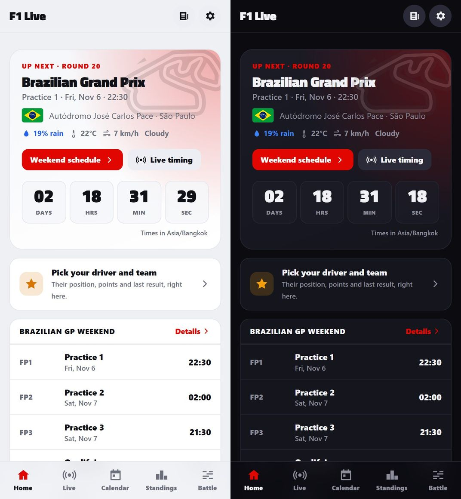
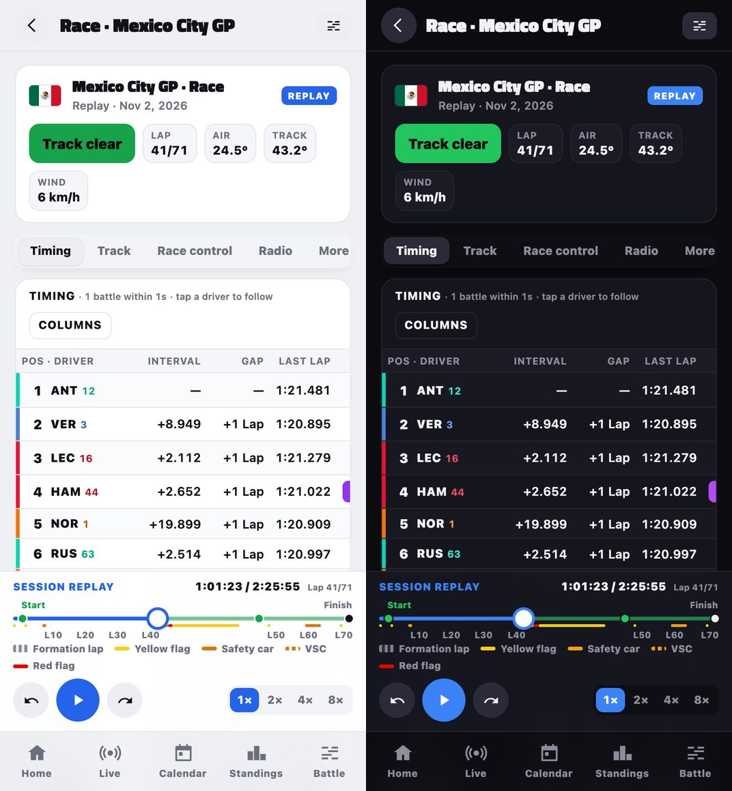
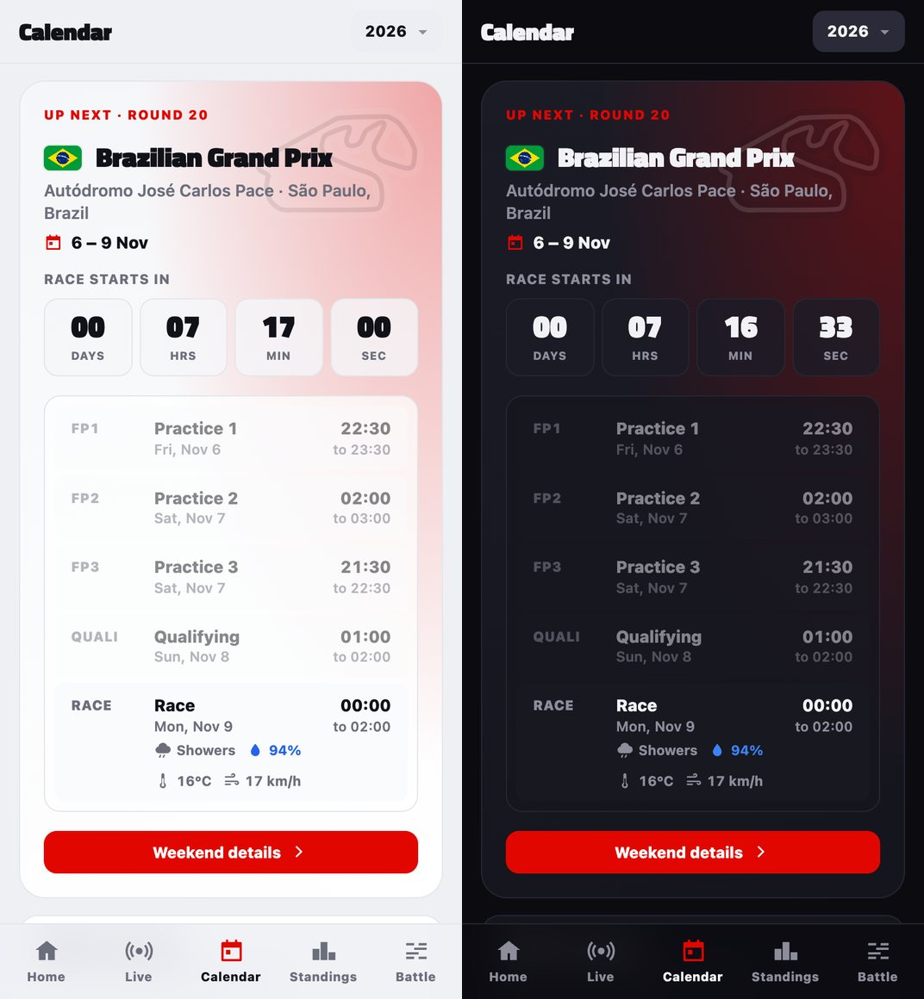
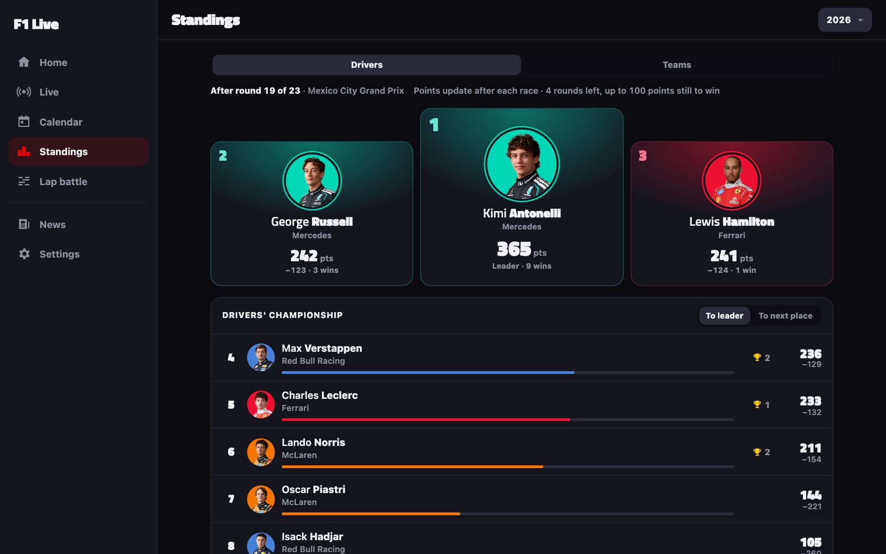
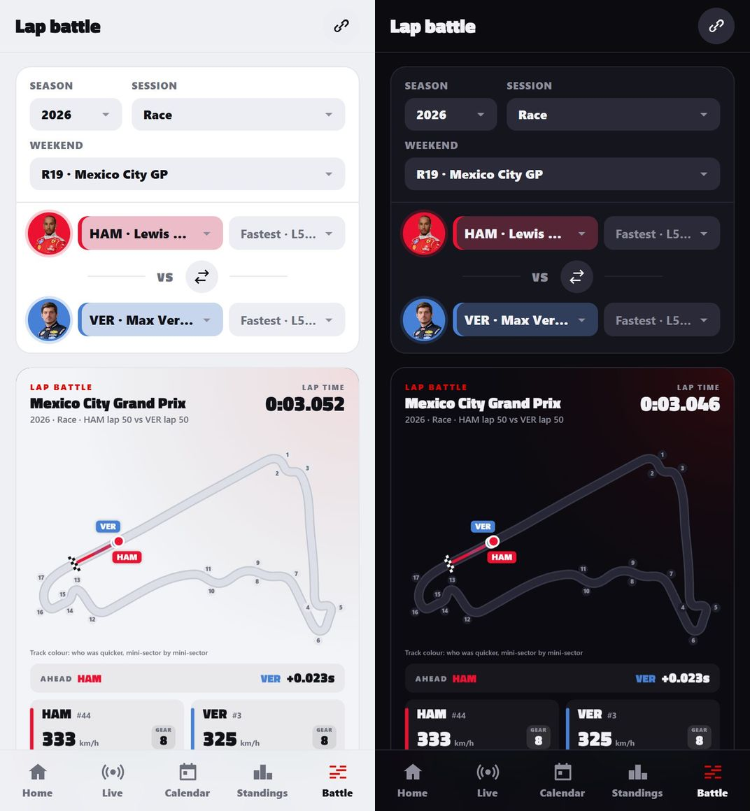
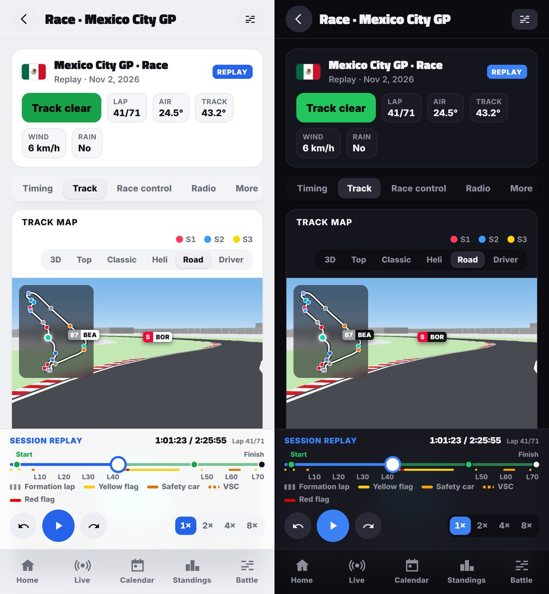
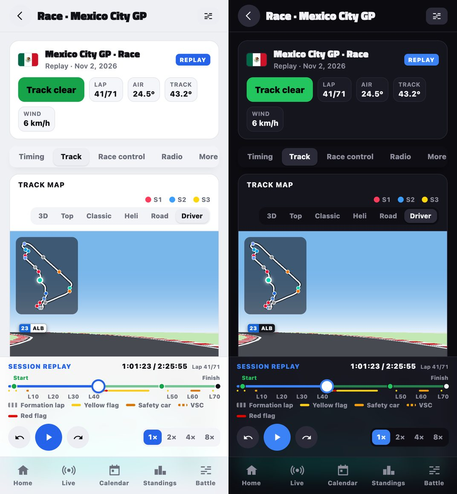

# F1 Live

[](https://github.com/IsaraApae/f1-live/actions/workflows/pages.yml) [](LICENSE)

A free Formula 1 companion in the browser: live timing, the track on a real 3D map, race control, weather, the season calendar in your own time zone, standings, full replays with car telemetry, and lap battles. No account, no ads, no tracking.

- **Website:** https://isaraapae.github.io/f1-live/
- **Built with:** plain JavaScript modules, HTML and CSS: no framework, no packages, nothing to build (the publish only minifies). [MapLibre](https://maplibre.org) draws the real map, [three.js](https://threejs.org) the 3D cars and [MediaPipe](https://github.com/google-ai-edge/mediapipe) cuts out 2023's photos, each loaded from a CDN only when a page needs it. Hosted on GitHub Pages, published by GitHub Actions.

In the same style as the [Alert Watch](https://github.com/IsaraApae/alert-watch) LINE cards: each driver as their code and car number (RUS 63), lists on their team's colour stripe, faces cut out. On a phone, in light and dark:

<p>
  
  
</p>
<p>
  
  
</p>
<p>
  
  
</p>
<p>
  
</p>

## What's in it

| Page | What it shows |
|---|---|
| **Home** | The next session with a countdown and the forecast at the circuit, a "live now" card during a session, the weekend's sessions, your driver and team (picked in Settings), the last race's podium (P2, P1, P3, the winner raised in the middle), the championship's top five and the latest headlines. |
| **Live** | Formula 1's live timing straight from its feed: timing tower (gaps, intervals, sectors, mini sectors, tyres, pit stops), the track map, track status, weather and the chance of rain, race control with pop-up alerts, penalties, team radio, tyre strategy, race positions, pit stops and the live championship. On a phone the panels sit under sub-tabs (Timing, Track, Race control, Radio, More), and the real map is only fetched once Track is opened. The panels come in when the session's first data has, so nothing is pushed down the page as it loads. |
| **Track map** | The circuit on a real map of its surroundings (streets, water, 3D buildings), tilted in 3D or seen from the top, with every car on it; or the classic flat outline. Three camera views ride with the car you follow (else the leader): **Heli** from high above and behind, **Road** a chase camera above and behind the car, and **Driver** from just behind the driver's head (your cockpit, halo and steering wheel). They have a clean, bright daytime look whatever the theme: pale ground, mint grass along the track, the track at its real width with white edges and red and white kerbs in the corners, white buildings and a blue sky, with a mini-map of the circuit in the corner. The pit lane is drawn properly too: the lane with its white lines, the pit wall and debris fence on the track's side, and a row of garages with see-through roofs. These three views can only be picked while there are cars on the map (a live session or a replay); otherwise they're greyed out and the map shows 3D. The cars are 3D F1 cars built in code with [three.js](https://threejs.org): smooth bodywork, wing profiles, halo, glossy paint in team colours, the race number, and a ring in the colour of the tyres each car is on. The real map needs WebGL 2; without it the classic outline shows. |
| **Calendar** | Every weekend of the season with session times in your time zone, countdowns, forecasts and winners (with their photos, every season since 2023). Each weekend has its own page with the podium, every session's results, driver photos and replays. A race's and a sprint's results (and the podium) show ▲/▼ for the places each driver gained or lost since the start, against the starting grid (or the qualifying order), as the LINE cards do. When penalties change the grid after qualifying, the qualifying shows a Grid penalties panel (P2 → P7 ▼5) and the drivers where they start, with ▼ for who dropped back and ▲ for who moved up into the gaps, and a switch back to the qualifying order. |
| **Standings** | Drivers' and teams' championships since 2023, with that year's driver photos, team logos and cars. The season picked here and on the Calendar is the same, with a page for each driver (stats, points chart, race-by-race results, teammate head-to-head) and each team (its drivers, car, teammate head-to-head and every race). |
| **Replays** | Any session since 2023, rebuilt lap by lap, on the same timing screen, opened from a weekend's page, Home or Live. Plus analysis: fastest laps, overtakes, track dominance between drivers, and car telemetry (speed, gear, throttle, brake, RPM, DRS) for the driver you follow. A finished session's data is kept in the browser (its cache storage, the last 250 answers), so a replay opened again loads in under a second; Settings → clear saved data removes it. |
| **Lap battle** | Two drivers' laps raced against each other round the circuit at 60 fps, with speed, throttle, brake and the time gap, in the site's dark or light look. Save it as a video to share. |
| **News** | Headlines from F1 publishers, linking to their articles. |
| **Settings** | Dark, light or device appearance, 12- or 24-hour clock, your driver and team, alerts. The site also follows the device's reduce-motion setting: nothing shimmers, pulses or flashes (a yellow sector stays lit). |

**Results after the race.** Jolpica can keep a race's result from before the stewards' post-race penalties for days (Mexico 2026: Hirakawa 13th with no points, officially 10th with 1). For this season's latest race, `js/final.js` puts what Jolpica says right from OpenF1's result: the race's positions and points, and the drivers' and teams' points, wins and order on Home, Standings and the driver and team pages. If OpenF1 can't be reached, Jolpica's figures are shown as they are. `?result=KEY` (the LINE cards' **Full result**) opens that session's weekend page with every driver, scrolled to it.

## Where the data comes from

| Source | Used for |
|---|---|
| Formula 1's live timing (`livetiming.formula1.com`) | Live timing; the browser connects to it directly |
| [OpenF1](https://openf1.org) | Replays, session times, telemetry, overtakes, pit stops, flags. Its free service pauses during a live session: the site then uses the last answers saved in the browser and Jolpica's calendar, without keeping pages waiting; replays and lap battles not saved in the browser come back about 30 minutes after the session |
| [Jolpica](https://github.com/jolpica/jolpica-f1) | Calendar, standings and results |
| [MultiViewer](https://api.multiviewer.app) | Circuit outlines and corner numbers |
| [OpenFreeMap](https://openfreemap.org) (OpenStreetMap data) with [MapLibre](https://maplibre.org) | The real map under the track |
| [three.js](https://threejs.org) | The 3D cars in those views |
| [bacinger/f1-circuits](https://github.com/bacinger/f1-circuits) | Circuit shapes, to place F1's track coordinates on the map |
| [Open-Meteo](https://open-meteo.com) | Forecasts at the circuit |
| Formula 1's pictures (`media.formula1.com`) | Driver photos, team logos and cars, flags and circuit drawings |
| [Titillium Web](https://fonts.google.com/specimen/Titillium+Web) (SIL Open Font License, in `fonts/`) | The headings' font |
| [MediaPipe](https://github.com/google-ai-edge/mediapipe) | Cutting 2023's driver photos out of their studio backdrop, in the browser |
| Publishers' RSS feeds | Headlines (collected by `scripts/news.mjs` when the site is published) |
| `pitlanes.json` (built from OpenF1 by `scripts/pitlanes.mjs`) | Every circuit's pit lane for the Live tab: one ordinary stop's path from the circuit's latest race. OpenF1 only answers free requests between sessions, so the Live tab doesn't ask it during one |

OpenF1 allows 30 requests a minute; `js/api.js` queues requests and waits when it's busy. During a live session OpenF1 refuses free requests; the site then stops asking it for a few minutes, without the "busy" banner (the live timing comes from Formula 1's feed).

Live car positions on the map are worked out from Formula 1's mini-sector marks (exact positions are only on F1 TV): `js/livepos.js` runs each car through every mini-sector at its own pace from its last lap, and the drawn car speeds up or slows down a little to stay with the marks, so it never jumps or goes backwards (checked by `tools/check.mjs`).

## Run it on your computer

```bash
python -m http.server 8000
```

Then open http://localhost:8000. There's no build step and nothing to install, and no environment variables or API keys: every data source is free and public. To see headlines locally, run `node scripts/news.mjs` once first (it writes `news.json`). `node tools/check.mjs` runs the same checks as a publish.

`index.html?feed=ws://localhost:PORT` points the Live tab at a local test feed instead of Formula 1's (only `localhost` and `127.0.0.1` are accepted).

## How the code is laid out

- `index.html`: the frame (top bar, side menu, bottom tabs). It asks for the first page's modules straight away, Home's or those of the page a LINE card opens (`?live`, `?replay=KEY`, `?result=KEY`), instead of one layer of imports at a time.
- `js/main.js`: moves between pages using the address's `#/…`.
- `js/views/`: one file per page.
- `js/timing.js`: the timing screen for both live and replays. `js/analysis.js` has the replay analysis panels; `js/geomap.js` the real map.
- `js/api.js`, `js/season.js`, `js/util.js`: data sources, the season calendar, shared helpers.
- `css/`: `app.css` for the frame and shared pieces, then one file per area. Only `app.css` holds up the first paint: an area's file is switched on just before one of its pages is first drawn (its `data-pages` in `index.html`), and Home and Settings need none.
- `sw.js` and `manifest.webmanifest`: installing as an app. Each release's own files are kept on the device, so an installed app opens pages it has seen, saved replays and lap battles without a connection.
- `fonts/`: Titillium Web, served from the site. `icons/og-image.jpg`: the card a shared link shows.

## Publishing

`.github/workflows/pages.yml` checks the code (`node tools/check.mjs`), collects the headlines, adds the pit lanes of circuits that have had a new race and publishes to GitHub Pages on every push to `main` and every 30 minutes (at 13 and 43 past the hour: GitHub starts scheduled runs late, or not at all, at the busy times on the hour and half hour). The README, its pictures and the build tools aren't published. The published scripts and styles are minified by esbuild (with source maps, so the browser's developer tools show the readable code); the repository's code stays as it is. Each release's scripts and styles get their own addresses (`?v=` and the commit: an import map and the stylesheet tags, which `tools/stamp.mjs` writes into `index.html`), because Safari keeps scripts in memory even across a reload: a page always loads one release whole, and if a release comes out while the site is open, a page that no longer fits reloads itself once. In the repository's **Settings → Pages**, the source must be **GitHub Actions**.

`.github/workflows/check.yml` runs the same checks on pull requests, and GitHub's code scanning (CodeQL, set up in the repository's settings) reads every pull request and `main`. The workflows' actions are pinned to exact commits, and Dependabot opens a pull request each week when one has a new version. `main` can't be force-pushed or deleted.

## Licence

The code is under the [MIT licence](LICENSE). It doesn't cover what the site shows from elsewhere: Formula 1's pictures, logos and timing data, the publishers' headlines and the other sources above belong to their owners, and Titillium Web is under the SIL Open Font License (`fonts/OFL.txt`).
